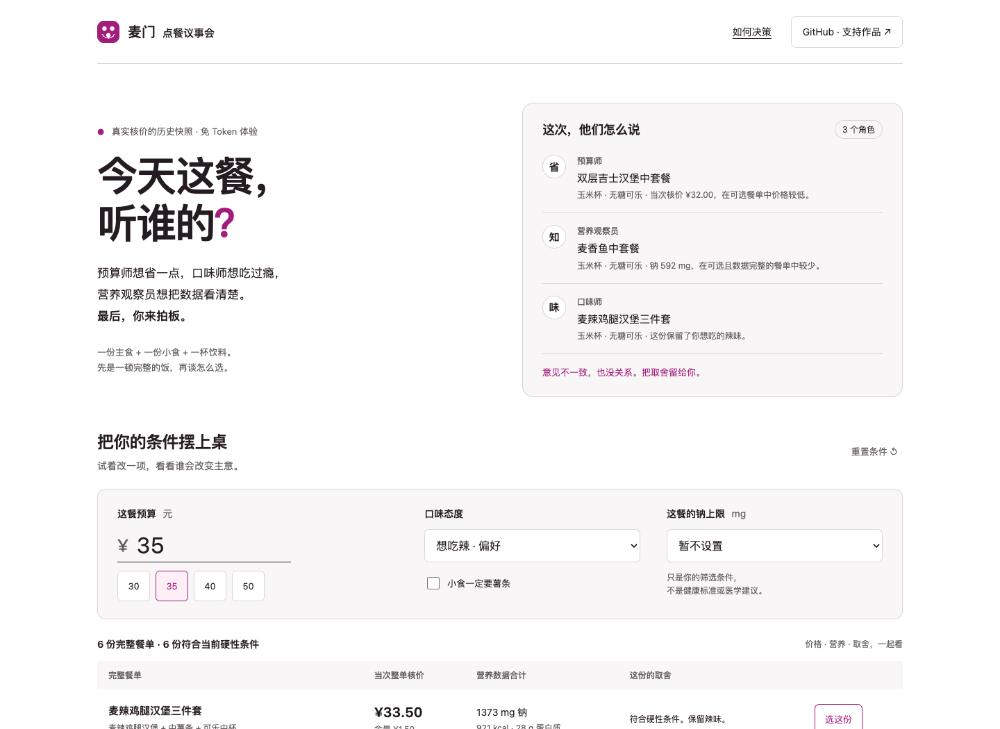

# 麦门点餐议事会 · mcd-agent-gourmet

**省钱、口味、营养数据意见不一时，把取舍摆上桌，最后由你决定。**

[打开在线体验](https://polaris-smart.github.io/mcd-agent-gourmet/) · [35 秒操作演示](https://polaris-smart.github.io/mcd-agent-gourmet/assets/demo.mp4) · [真实联调记录](docs/validation.md) · [安装 Skill](#在-workbuddy-里使用) · [English](README_EN.md)



预算 35 元，想吃辣，一份主食、一份小食、一杯饮料。预算师、营养观察员和口味师会选同一份吗？

| 角色 | 本次选择 | 理由 |
|---|---|---|
| 预算师 | 双层吉士汉堡 + 小杯玉米杯 + 无糖可口可乐中杯 | 当次整单核价 **¥32.00**，在候选中价格较低 |
| 营养观察员 | 麦香鱼 + 小杯玉米杯 + 无糖可口可乐中杯 | 当次 **¥32.50**；官方标准份量单品合计钠 **592 mg**，在候选中较少 |
| 口味师 | 麦辣鸡腿汉堡 + 小杯玉米杯 + 无糖可口可乐中杯 | 当次 **¥32.00**，保留辣味偏好 |

上表是 **2026-10-13 麦当劳南京东城汇餐厅的真实核价快照**，不是当前报价，也不是营养搭配建议。实际购买须重新核价。我们比较六份候选，不保证全菜单最低价。

## 先试 30 秒

直接 [打开网页](https://polaris-smart.github.io/mcd-agent-gourmet/)，不用账号、Token 或安装。

- 把预算改成 **30 元**：没有符合条件的候选，系统如实说明，不把一杯可乐当一餐。
- 改回 **35 元**，勾选 **小食一定要薯条**：玉米变体被排除，不偷偷替换你的需求。
- 选择 **不吃辣**、钠上限 **800 mg**：只保留满足你设定条件的餐单。上限是个人筛选条件，不是健康标准。
- 选一份餐单，再改变条件：原选择自动撤销，需要重新确认。

网页使用历史快照，所有比较在你的浏览器内完成，不收集凭证、不调用下单、不加入追踪器。

## 本地运行

Python **3.9+**，仅标准库，零第三方依赖。

```bash
git clone https://github.com/polaris-smart/mcd-agent-gourmet.git
cd mcd-agent-gourmet
python3 demo.py
python3 demo.py --budget 35 --taste no-spicy --sodium-limit 800
python3 demo.py --budget 35 --taste spicy --side fries --json
```

默认读取 `fixtures/snapshot.json`。即使本机有 Token，也不会自动联网。

### 实时核价

1. 在 [麦当劳开放平台](https://open.mcd.cn/mcp) 申请自己的 MCP Token。
2. 在本机私有环境中设置 `MCD_MCP_TOKEN`。不要提交到 Git，也不要粘贴到公共对话或网页。
3. 先核对 `fixtures/plan.json` 中的门店。默认是本项目测试的南京东城汇餐厅，**不是自动定位到你的附近门店**。换店需从 `query-nearby-stores` 的返回中选择门店编码，再核对该门店菜单和套餐详情。
4. 显式运行：

```bash
python3 demo.py --list-tools
python3 demo.py --live --plan fixtures/plan.json --budget 35 --taste spicy
```

程序会读取当次菜单、官方营养数据、门店可用券，再对六份完整餐单逐份 `calculate-price`。真实查询失败会停止，**不拿历史快照伪装成实时结果**。当前模板只支持到店取餐、即时三轮套餐；默认不使用优惠券。

高级用券：在私有计划文件的某一候选下提供成对的 `couponId`、`couponCode`，由官方核价接口验证；不自动领券、不枚举全部券、不保证最优用券。实际用券正向链路尚未验证，见 [验证边界](docs/validation.md)。

```bash
python3 demo.py --live --plan local/my-plan.json --save-snapshot local/quotes.json
```

`--save-snapshot` 保存脱敏餐单快照；不包含 Token、券 ID、账号信息。保存后即标为历史快照。新核价也仅在本工具 15 分钟复核窗口内允许按实时结果选择；这不是官方价格有效期承诺。

## 在 WorkBuddy 里使用

先按官方文档配置麦当劳 MCP 连接器。`mcp-config.example.json` 只含环境变量占位符；若客户端不支持变量展开，请只在该客户端的私有配置中设置实际凭证。

可以把下面这段发给 WorkBuddy：

```text
请安装这个技能：https://github.com/polaris-smart/mcd-agent-gourmet
保留 SKILL.md、gourmet/、demo.py、fixtures/ 的相对位置。
使用我已配置的麦当劳 MCP 连接器。

帮我比较一顿完整的餐：主食、小食、饮料各至少一份，预算 35 元，想吃辣。
先让我选门店，再查当前菜单和套餐组成，逐份官方核价。
分别给出预算、营养数据、口味三个角度的意见，说明分歧；最后让我选。
只查询和核价，不领券、不下单、不支付。
```

**实现说明：** Python 和网页是三个确定性规则审阅器，不是三个独立大模型。`SKILL.md` 定义了 AI 客户端中的角色协作流程：支持独立子任务的客户端可分角色审阅相同的事实包；不支持时顺序审阅并明确说明。两种方式都不能让角色编造价格、营养数据或擅自下单。

## 我们具体解决什么

- **先完整，再便宜。** 只有满足主食、小食、饮料和份数要求的餐单才进入候选。
- **硬性条件与偏好分开。** “不吃辣”严格排除；“想吃辣”作为偏好，无法满足时解释替代。
- **意见可以不同。** 三角色分别按价格、已知钠含量、口味匹配给出意见，拒绝不透明的综合评分。
- **未知就是未知。** 营养表按餐品完整名称精确匹配。无法匹配则保留 `null`；不能把缺失变成 0，也不输出“营养均衡”标签。
- **钱算在整单上。** `calculate-price.data.price` 的整数分才是价格依据；更换套餐内饮品或小食必须重新核价。
- **选择不是下单。** `--select` 和网页按钮只记录餐单决定，不创建订单或支付。

适合预算有限、想看清取舍的个人用户，以及学习真实业务 MCP、Agent 角色审阅和失败处理的开发者。当前不处理多人分摊、过敏原判断、医学饮食建议、自动下单或全菜单最优搜索。

## 验证与开发

```bash
python3 -B -m unittest discover -s tests -v
node tests/parity.cjs                  # 可选开发检查，需要 Node.js
python3 -B scripts/build_demo.py       # 从同一快照生成网页数据
```

[验证记录](docs/validation.md) 区分真实接口运行、离线测试、浏览器检查和未验证内容。[改进记录](CHANGELOG.md) 说明从原演示修正了什么。

```text
gourmet/core.py       完整餐单检查、三角色意见、选择记录
gourmet/mcp.py        标准 Streamable HTTP、只读白名单、错误处理
gourmet/live.py       套餐选项、官方核价、营养表解析
demo.py              本地演示与显式实时入口
fixtures/plan.json   六份候选模板，不含凭证
fixtures/snapshot.json  脱敏真实历史快照
docs/                免 Token 网页体验与说明
tests/               Python 回归与 Python/JS 决策一致性
```

## 参赛与贡献

M-CODE 2026 独立参赛作品，非麦当劳官方产品。[官方报名记录](https://github.com/M-China/mcd-developer-innovation-challenge/issues/565)。本次修订使用 Codex 辅助，历史 WorkBuddy 使用记录单独保留，不将本次工作冒充 WorkBuddy 对话。

欢迎提 Issue，描述“我输入了什么、期望什么、实际出现什么”；**不要附 Token、账号或原始优惠券数据**。如果这个透明决策的思路对你有帮助，欢迎点一颗 Star。

原创代码采用 [MIT License](LICENSE)。官方参赛声明按官方原文保留，相关商标与服务条款归权利人所有。输出仅供参考，餐品信息、价格和供应状态以官方当前结果为准，不构成医疗、营养或其他专业建议。
