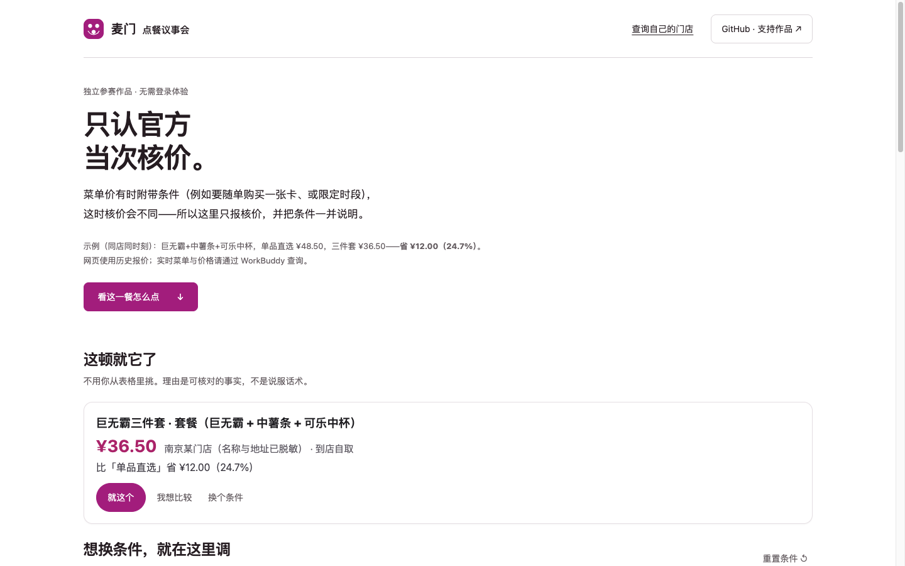
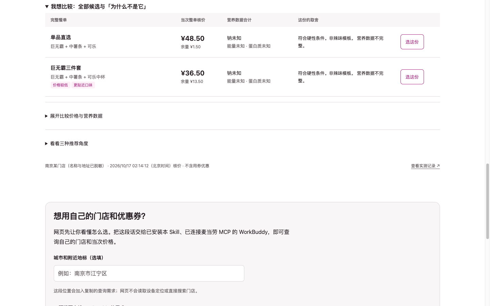

# 麦门点餐议事会 · mcd-agent-gourmet

**同样的东西，两条点法差 ¥12.00（24.7%）。** 价格一律以麦当劳官方当次核价为准：菜单价有时附带条件（例如需要随单购买一张卡），这种情况下核价会不同——所以它只报核价，并把条件一并说明。

这就是它做的事：**把你这一餐真正要付的钱算出来**，再告诉你有没有更便宜的点法。金额一律来自官方 `calculate-price` 的整数分；菜单展示价只作参考，附带条件会一并说清。

**「35 元，不辣，有糖可乐去冰，带走。」** 一句话说清需求，给你**一个答案 + 一张能照着点单的清单**；没有满足条件的方案就直说没有，不会用不完整的餐单凑数。

[打开在线体验（免登录）](https://polaris-smart.github.io/mcd-agent-gourmet/) · [安装 Skill](#在-workbuddy-里使用) · [真实联调记录](docs/validation.md) · [English](README_EN.md)

> **English TL;DR** — A read-only McDonald's China MCP client + agent skill. Say *"35 yuan, not spicy, regular cola, no ice, takeaway"* and it compares **complete** meals (main + side + drink) using official per-order pricing, tells you **why each rejected meal lost** (dominated by which candidate, on which axis), and when nothing fits it says so — plus how much budget would actually be needed. An explicit regular-cola choice is never silently swapped for zero sugar. [English README](README_EN.md) · [30-second demo](https://polaris-smart.github.io/mcd-agent-gourmet/)



## 先试 30 秒

不用账号、Token 或安装：

- **打开就是答案**：默认直接给出这一餐（巨无霸三件套 ¥36.50）和一句可核对的理由——「比单品直选省 ¥12.00（24.7%）」。
- 点 **「就这个」**：出现可复制的点单卡（门店 / 取餐方式 / 每样官方名称 / 合计）。
- 把预算改成 **30 元**：它说没有方案，并告诉你最低需要多少（¥36.50）——不硬凑。
- 想看别的，点 **「我想比较」**：才展开全部候选与「为什么不是它」。默认不给表格。



网页使用历史快照，所有比较在你的浏览器内完成，不收集凭证、不调用下单、不加入追踪器；本项目为独立参赛作品，非麦当劳官方产品。也可看 [35 秒录屏演示](https://polaris-smart.github.io/mcd-agent-gourmet/assets/demo.mp4)（v0.2 界面录制）。

## 首屏长这样（一个答案，不用你挑）

真实核价快照上的实际输出（门店：演示门店（名称已脱敏），2026-10-17）：

```
这顿就它了 👇

  巨无霸三件套 · 套餐（巨无霸 + 中薯条 + 可乐中杯）
  ¥36.50   演示门店（名称已脱敏） · 到店自取
  比「单品直选」省 ¥12.00（24.7%）

点单卡（可复制）
  门店：演示门店（名称与编码已脱敏）· 到店自取
  1. 巨无霸
  2. 中薯条
  3. 可乐中杯
  合计：¥36.50
  比「单品直选」省 ¥12.00（24.7%）
  以上只是记录你的选择；没有下单、没有支付。
```

- **默认只给一个答案**，不让你在 3 份表格里做多目标权衡；理由必须是可核对的事实（省了多少钱 / 价格最低 / 钠最低），不是说服文案。
- **点单卡**是最终产出物：门店、取餐方式、每样官方名称、合计——照着在 App 或柜台点即可。
- 想看别的：`--compare` 才展开全部候选与「为什么不是它」。

## 目标用户

- **一个人或两个人吃饭**、预算有限、对口味有明确偏好的人；
- 以**到店自取 / 外带**为主，想在下单前把「这一顿多少钱、怎么点更划算」算清的人；
- 需要把**钠 / 能量 / 蛋白质**当筛选条件的人（条件由你自己设，不是健康建议）；
- 用 **WorkBuddy 等 AI 客户端**、希望"说一句话就得到可核价餐单"的人；
- **开发者**：想看一个只读 MCP 客户端 + 确定性比较 + 可复算省钱数字的实现样板。

## 三件我们做死的事

1. **钱必须是真数**：金额只认官方 `calculate-price` 返回的整数分；菜单展示价附带的条件（例如「随单购麦金卡」）会一并说清。例：巨无霸三件套菜单价 ¥36.50、官方核价也是 ¥36.50；带「随单购卡」条件的商品两者会不同，此时它会同时显示条件与核价。
2. **你的硬约束只说一次**：不辣、去冰、有糖……记住你的条件，不反复问，也**不因为"营养更优"替你改**。
3. **两个人也能算**：份数完备性按人数（主食与饮料各 ≥ 人数），比较用人均价，而不是拿"两人总价"去比"一人总价"。

再加上一条：不领券、不兑换、不下单、不支付，也没有购物车。

## 它做什么

“35 元，不辣，有糖可乐去冰，带走。帮我看看附近哪家店合适。”这是我们希望用户直接表达的需求。Skill 会先补齐地点、让你确认门店，再比较完整餐单，不要求普通用户复制门店、商品或券的编码。**这条路径由安装了 Skill 的 AI 客户端执行；网页是免登录的历史数据体验，CLI 是开发者入口。**

比较程序按价格、已知钠含量、口味匹配三个明确标准给出结果。同一餐单可能符合多个标准；这不代表三个独立模型进行了讨论，也不承诺全菜单最优。

<details>
<summary>查看历史核价示例：预算 35 元、想吃辣，三个比较角度为什么选不同餐单</summary>

| 比较角度 | 本次选择 | 理由 |
|---|---|---|
| 价格较低 | 双层吉士汉堡 + 小杯玉米杯 + 无糖可口可乐中杯 | 当次整单核价 **¥32.00**，在候选中价格较低 |
| 钠含量较少 | 麦香鱼 + 小杯玉米杯 + 无糖可口可乐中杯 | 当次 **¥32.50**；官方标准份量单品合计钠 **592 mg**，在候选中较少 |
| 更贴近辣味偏好 | 麦辣鸡腿汉堡 + 小杯玉米杯 + 无糖可口可乐中杯 | 当次 **¥32.00**，保留辣味偏好 |

上表是 **2026-10-13 演示门店的真实核价快照**，不是当前报价，也不是营养搭配建议。实际购买须重新核价。我们比较六份候选，不保证全菜单最低价。

</details>

## 和下单渠道是什么关系

App 是**下单**的地方；这里是**打开 App 之前**把「这顿怎么点」算清楚的地方。

- **下单仍在麦当劳 App 或门店完成**；本工具不提供购物车、不代下单。
- 它只做「打开下单渠道之前」的那一步：把你的条件变成**可核价的完整餐单**，并说明取舍。
- 没有符合条件时会直说，并给出**保持其他条件的预算阶梯**（差多少钱、加多少后有几份可选）。
- 不领券、不兑换、不下单、不支付。

两者不冲突：用它决定点什么，用 App 完成购买。

## 在 WorkBuddy 里使用

先按官方文档配置麦当劳 MCP 连接器。`mcp-config.example.json` 只含环境变量占位符；若客户端不支持变量展开，请只在该客户端的私有配置中设置实际凭证。

可以把下面这段发给 WorkBuddy：

```text
请安装这个技能：https://github.com/polaris-smart/mcd-agent-gourmet
保留 SKILL.md、gourmet/、demo.py、fixtures/ 的相对位置。
使用我已配置的麦当劳 MCP 连接器。

35 元，不辣，有糖可乐去冰，主食、小食、饮料各一份，带走。
我在南京江宁区。先显示门店名称和地址，让我选店。
再查当次菜单，给我最多三份符合要求的方案，说明价格和取舍。
没有满足条件的方案时说明原因，先别替我改饮料或加预算。
只查询和核价，不领券、不兑换、不下单、不支付。
```

偏好可按自己的习惯改成无糖或其他可选饮料。门店编码由客户端从查询结果中传递；不能在没有位置依据时声称自动选中了“离你最近”的店。

**实现说明：** Python 和网页使用确定性筛选、排序与非支配集合比较。`SKILL.md` 引导 AI 客户端理解需求、查询并解释结果，不制造三个独立模型的角色对话。新版在 WorkBuddy 客户端中的完整对话路径仍需验收，详见 [验证记录](docs/validation.md)。

## 两个零输入入口（不用你描述需求）

| 入口 | 行为 |
|---|---|
| **随便来一份**（`--any`） | 不设预算时**明说"未设预算"**，只按其他硬性条件给一个默认答案；不会偷偷替你假定一个预算 |
| **跟上次一样**（`--last`，需 `--live`） | 读最近一次订单，**只复用门店与商品编码**，按当次价重新核价（不复用历史金额）；上次的商品若已售罄会逐条告诉你并去掉，**不替换**；上次那家店不在营业时间就明说，退回默认方案 |
| **企业团餐 / 主题派对** | **不是个人点餐的渠道**，属于独立场景（`query-meal-assistance` / `party-*`），本工具不把它们混进来 |

## 先说清楚它查不到什么（免得你白等）

官方 MCP 覆盖的是麦当劳自有渠道的只读数据。下面三类**现在拿不到**，遇到时它会直说，而不是猜：

1. **券/卡的完整条款原文**：「不与其他优惠同享」的具体边界没有对应工具，只有券名、官方状态与时间字段。
2. **麦金卡 / 早餐卡的实时权益**（剩余次数、适用门店）：35 个工具里没有对应入口。
3. **份量 / 克重 / 尺寸**：没有数据源，所以它不会回答「是不是缩水了」，只会给同价位的替代方案。

另外，MCP **不含美团、饿了么、京东、抖音、淘宝闪购等第三方渠道**——第三方价格与券以各渠道自己的页面为准。以上三类之外的实时价格、门店供应、营业状态、券的可用性判定，都走官方接口。

## 0.4：把「为什么不是它」也讲清楚

- **前沿解释**：每个比较角度（价格与钠 / 口味与钠 / 多维营养）除了列出候选，还会说明其他候选**被谁比下去、差在哪个维度**。例如「从价格与钠角度看，为什么没有 cheese-classic：被 cheese-corn 比下去——价格更低（¥32.00 vs ¥33.50）；钠更低（1053 mg vs 1182 mg）」。同值并列保留，不制造虚假胜出；数据不完整的候选单独列出「因数据不完整未参与比较」，不当 0 分。
- **预算阶梯**：预算不足时不再只报一个「最低需要多少钱」，而是给出阶梯——「¥32.00 → 可选 2 份；¥32.50 → 3 份；¥33.50 → 5 份」，并明确**只调整预算，不放宽口味、小食、饮料或营养条件**。
- 两条都只做解释与提示：不替用户改条件、不自动加预算，也不给健康评分。

## 0.3：按普通人的点餐方式使用

“35 元、不辣、有糖可乐去冰、带走”或“35 元、不辣、无糖可乐去冰、带走”应当是一句话。有糖和无糖都是平等的口味选择，未指定时不默认无糖。WorkBuddy Skill 会补问缺失的门店或配送地址，按官方选项构造餐单，解释未满足的条件，不要求普通用户查商品或券 ID。

- **糖与冰量**：有糖可乐／无糖可乐／都可以并列展示，明确选择后不会因营养排序而擅自替换；标准冰、少冰、去冰、多冰使用当次官方特调 key。去酱、去菜按完整配料名匹配，重新核价，去配料后标准营养合计改为未知。
- **门店与组合**：搜索门店、查看当次菜单、选择套餐；按可售的小食×饮料最多展开 12 份并逐份核价。供应缺失就说明，不能把旧店套餐当成全国通用。
- **多维取舍**：个人能量上限、蛋白质下限，以及价格/钠/能量/蛋白质的非支配候选；不输出任意健康评分。
- **没有合适餐单时**：只有预算阻碍时显示保持其他条件所需的最低候选预算；否则提示扩展候选或由用户调整条件，不自动放宽。
- **少重复填写**：网页可主动点击“记住我的条件”，仅在当前浏览器保存，可随时清除。复制到 WorkBuddy 的文字会携带当前偏好和履约意图。

网页收录的独立历史样例由 `fixtures/demo-snapshots.json` 管理，当前包括三组南京门店样例；**其中一组的门店名与地址已脱敏**，因为该门店位于作者住所附近，公开它等于公开个人位置。其余两组均包含实测“薯条＋有糖可乐”和“薯条＋无糖可乐”的去冰组合。各组独立标明门店、公开地址与核价时间，不跨店混比；脱敏只作用于门店标识，核价与营养数据未做修改。网页不实时核价、不接受 Token。

以下命令供开发者调试；日常使用可直接采用上面的 WorkBuddy 对话入口。

```bash
python3 demo.py --sugar zero --energy-limit 700 --protein-min 20
python3 demo.py --search-stores --city 南京 --keyword 新街口
# 用返回的真实门店和套餐编码替换下列占位文本
python3 demo.py --list-meals --store-code 门店编码
python3 demo.py --live --store-code 门店编码 --meal-code 套餐编码 --expand --sugar zero --ice none
```

没有核验冰量的历史样例不能被改成去冰报价。CLI 当前只自动构造三轮完整套餐；全部杯型、儿童玩具、辣度分级及过敏原尚未完整支持。

### 积分、优惠券与到店/配送

**先看看手里的券：什么时候能用，这一餐用不用得上。**

在 WorkBuddy 中可以直接说：“看看我的券哪些快到期。如果我去附近那家餐厅带走，有没有适合这顿饭的？先别替我改有糖可乐去冰的要求。”Skill 会区分券包、时间窗口和门店适用性；需要选店或确认餐品时再补问。

```bash
python3 demo.py --coupon-demo       # 构造样例，不联网；六张均设为官方当前不可用，仅演示日期/时段分档
python3 demo.py --my-coupons        # 只查询自己的券，默认给可读报告
python3 demo.py --my-coupons --json # 完整脱敏明细，不保存到文件
# 门店编码来自用户确认后的查询结果；以下是开发者入口
python3 demo.py --my-coupons --store-code 门店编码
python3 demo.py --my-coupons --channel delivery --store-code 配送门店编码 --business-code 成对业务编码
```

报告分别展示官方当前状态、日期原文、本地解释的时间窗口、门店查询结果。早餐未开窗、今天已关窗但明天还能用、工作日限制、跨午夜窗口分别处理。“24 小时内结束”不等于“今天到期”；距截止时长不等于连续可用时长。不认识的限制标待核验，纯日期不补成精确截止时间。同名券不推断叠加，已结束的券不列入临期待关注清单。

门店核验用券标识在内存中匹配，输出不含券码；查询成功也不等于已获优惠。接下来复用下方“可用券查询与按名称核价”，才能确认本次应付。单品券不能强套到三轮套餐；到店查券也不能独自证明支持外带，需要官方核价返回的取餐方式。**本来不需要买，就不必为了用券消费。**

```bash
python3 demo.py --member
python3 demo.py --points-products
python3 demo.py --points-detail 商品SPU编号
python3 demo.py --addresses
python3 demo.py --delivery-stores --address-ref 查询返回的引用
python3 demo.py --list-coupons --channel delivery --store-code 配送门店编码 --business-code 成对业务编码
```

会员输出只保留积分与券的必要展示字段，不输出账号 ID、券码。地址只显式查询，隐藏姓名、电话及后续门牌；稳定引用防止地址列表变动选错地址。

**积分兑换与券的适用渠道是两次核验。** 兑换积分、兑换现金和用券额外现金分别展示，官方须知原文保留。不能直接按比例把积分抵预算，也不能保证所有积分券支持麦乐送。拥有券后，按当前门店与渠道查询可用券并官方核价。

堂食/外带选项来自核价的 `takeWayList`；到店使用 `beType=1/orderType=1`，得来速为 `5/1`，麦乐送为 `2/2`，后两者须使用相应门店返回的 `beCode`。菜单、券和核价全程一致；配送费用保留官方结果，不用到店价冒充送到家价格。

完整的 **35 个 MCP 工具能力地图、接入状态与未实现范围**见 [能力说明](references/mcp-capabilities.md)。本程序不领券、不兑换、不下单，也不自动抽奖。

### WorkBuddy Skill 市场

已按官方格式补齐元数据与资源目录，可构建 ZIP 分发包：

```bash
python3 scripts/build_skill_package.py --output /tmp/mcd-agent-gourmet-0.3.2.zip
```

包可用于开放平台投稿，**目前未提交审核、未上架**。安装与上架文案见 [市场发布说明](docs/workbuddy-market.md)。Skill 优先使用客户端已配置的麦当劳 MCP；脚本只需 Python 标准库。

## 本地运行

Python **3.9+**，仅标准库，零第三方依赖。

```bash
git clone https://github.com/polaris-smart/mcd-agent-gourmet.git
cd mcd-agent-gourmet
python3 demo.py
python3 demo.py --budget 35 --taste no-spicy --sodium-limit 800
python3 demo.py --budget 35 --taste spicy --side fries --json
```

默认读取 `fixtures/snapshot.json`。即使本机有 Token，也不会自动联网。

### 实时核价

1. 在 [麦当劳开放平台 MCP 登录页](https://open.mcd.cn/mcp/login) 用手机号登录后申请自己的 MCP Token；工具清单、限额与字段说明见 [官方文档](https://open.mcd.cn/mcp/doc)。
2. 在本机私有环境中设置 `MCD_MCP_TOKEN`。不要提交到 Git，也不要粘贴到公共对话或网页。
3. 先搜索并选择门店。实时模式必须明确传入 `--store-code` 或已确认的 `--plan`，不会自动沿用南京样例店。再用 `--list-meals` 查看该店当次菜单，用 `--meal-code` 选择套餐。只传门店编码不会载入演示套餐；覆盖计划的旧门店时，必须重新选择餐品及适用的渠道业务编码。
4. 显式运行：

```bash
python3 demo.py --list-tools
python3 demo.py --live --plan fixtures/plan.json --budget 35 --taste spicy
```

程序读取当次菜单、官方营养数据，对候选逐份 `calculate-price`。真实查询失败会停止，**不拿历史快照伪装成实时结果**。自动构造支持即时三轮套餐；到店已实测，配送/得来速参数已接入但未完成真实核价联调。默认不使用优惠券。

### 可用券查询与按名称核价

默认演示和实时核价均不带券。查询入口只显示券名称及适配的候选 ID，不要求用户知道券 ID：

```bash
python3 demo.py --list-coupons --plan fixtures/plan.json
python3 demo.py --live --plan fixtures/plan.json --coupon-title '查询返回的完整券名称' --coupon-candidate chicken-classic
```

`candidate_ids` 为空表示这张券不匹配当前六份套餐；单品券不会硬套到套餐。名称重复、商品不匹配或券标识缺失均停止。程序只在内存中解析成对标识并交给官方核价，不自动领券。传入券不代表已获优惠，只有官方报价可作为价格依据；真实用券成功链路尚未验证。高级用户仍可在私有计划文件显式提供成对字段。

```bash
python3 demo.py --live --plan local/my-plan.json --save-snapshot local/quotes.json
```

`--save-snapshot` 保存脱敏餐单快照；不包含 Token、券 ID、账号信息。保存后即标为历史快照。新核价也仅在本工具默认 15 分钟复核窗口（可用 `--freshness-minutes` 配置为 1～60 分钟）内允许按实时结果选择；这不是官方价格有效期承诺。

## 同时比较两个维度

网页和 CLI 提供“价格与钠”“口味与钠”两组取舍候选。先筛掉不满足硬性条件或数据不完整的餐单；如果另一份餐单在所比较的每个维度都不差、且至少一个维度更好，当前餐单才被淘汰。同值并列保留，不加秘密权重。“价格与钠”不额外优化软性辣味偏好，但仍遵守有糖/无糖、不吃辣等已明确的硬性条件。

另有价格、钠、能量、蛋白质四维比较：在这组目标下，价格、钠与能量越少，蛋白质越多越优。这是明确的比较方向，不是普遍健康结论。结果可能有多份互不支配的候选，甚至保留全部候选；不把集合包装成唯一“均衡最优”，也不计算没有依据的 0–100 健康分数。

例如在历史快照、预算 35 元且明确“想吃辣”时，“价格与钠”保留 ¥32.00 / 1053 mg 和 ¥32.50 / 592 mg 两种选择；“口味与钠”保留辣味餐与钠更少的非辣餐。只比较已逐份核价的有限候选，尚未穷举全菜单组合。

[后续改进清单](docs/backlog.md) 记录偏好矩阵、门店体验和组合扩展。

## 我们具体解决什么

- **先完整，再便宜。** 只有满足主食、小食、饮料和份数要求的餐单才进入候选。
- **硬性条件与偏好分开。** “不吃辣”严格排除；“想吃辣”作为偏好，无法满足时解释替代。
- **比较标准透明。** 分别按价格、已知钠含量、口味匹配筛选；多个标准可能选中同一餐单，不制造虚假的“争论”。
- **未知就是未知。** 营养表按餐品完整名称精确匹配。无法匹配则保留 `null`；不能把缺失变成 0，也不输出“营养均衡”标签。
- **钱算在整单上。** `calculate-price.data.price` 的整数分才是价格依据；更换套餐内饮品或小食必须重新核价。
- **选择不是下单。** `--select` 和网页按钮只记录餐单决定，不创建订单或支付。

适合预算有限、想看清取舍的个人用户，以及学习真实业务 MCP、Agent 角色审阅和失败处理的开发者。当前不处理多人分摊、过敏原判断、医学饮食建议、自动下单或全菜单最优搜索。

## 验证与开发

```bash
python3 -B -m unittest discover -s tests -v
node tests/parity.cjs                  # 可选开发检查，需要 Node.js
python3 -B scripts/build_demo.py       # 从同一快照生成网页数据
```

[验证记录](docs/validation.md) 区分真实接口运行、离线测试、浏览器检查和未验证内容。[改进记录](CHANGELOG.md) 说明从原演示修正了什么。

```text
gourmet/core.py       完整餐单检查、三角色意见、选择记录
gourmet/mcp.py        标准 Streamable HTTP、只读白名单、错误处理
gourmet/live.py       套餐选项、官方核价、营养表解析
demo.py              本地演示与显式实时入口
fixtures/plan.json   六份候选模板，不含凭证
fixtures/snapshot.json  脱敏真实历史快照
docs/                免 Token 网页体验与说明
tests/               Python 回归与 Python/JS 决策一致性
```

## 参赛与贡献

M-CODE 2026 独立参赛作品，非麦当劳官方产品。[官方报名记录](https://github.com/M-China/mcd-developer-innovation-challenge/issues/565)。本次修订使用 Codex 辅助，WorkBuddy 历史材料与证据状态单独说明，不将本次工作冒充 WorkBuddy 对话。

欢迎提 Issue，描述“我输入了什么、期望什么、实际出现什么”；**不要附 Token、账号或原始优惠券数据**。如果这个透明决策的思路对你有帮助，欢迎点一颗 Star。

原创代码采用 [MIT License](LICENSE)。官方参赛声明按官方原文保留，相关商标与服务条款归权利人所有。输出仅供参考，餐品信息、价格和供应状态以官方当前结果为准，不构成医疗、营养或其他专业建议。
